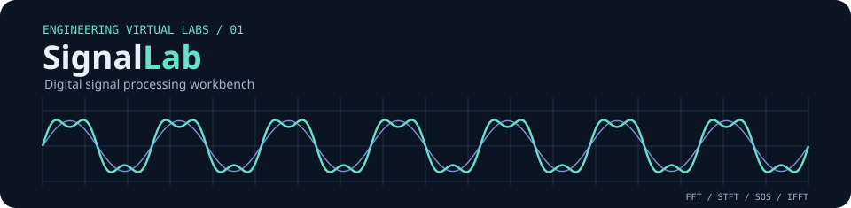
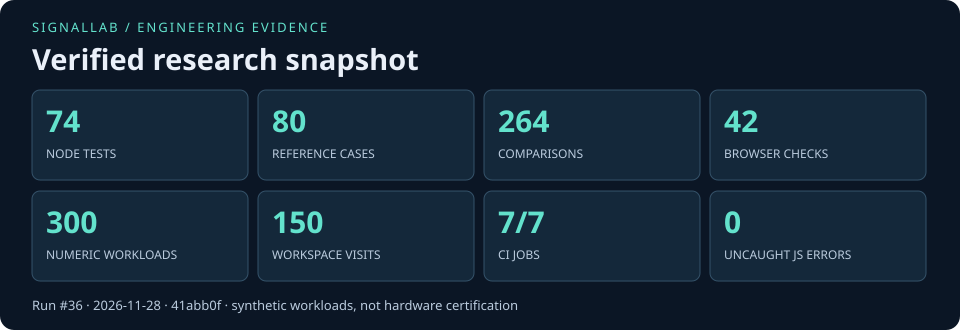
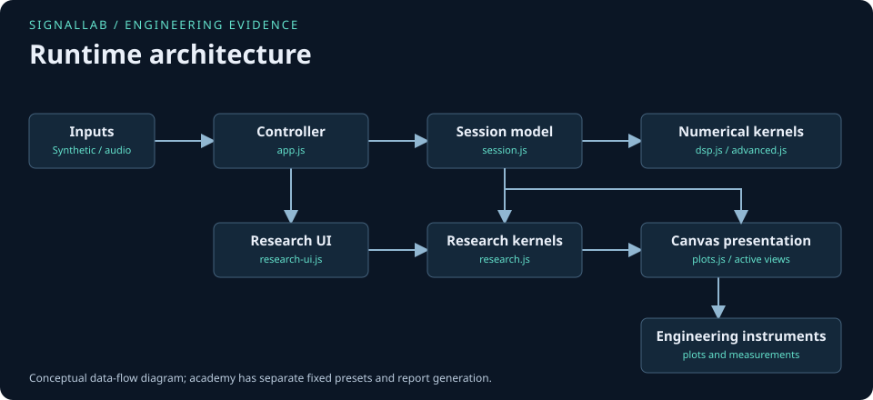
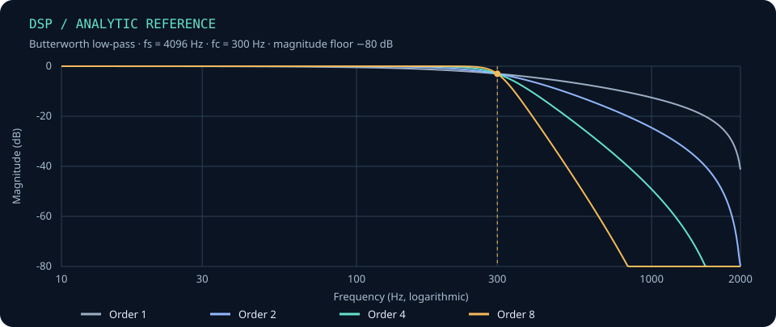
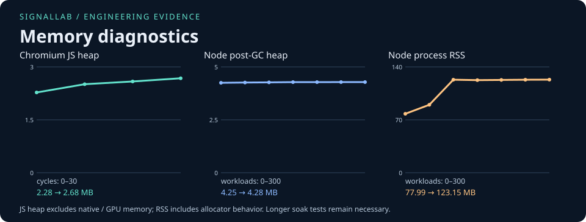

<p align="center"></p>

# SignalLab | Engineering Virtual Labs 01

**A browser-native DSP laboratory for electrical engineering.** Generate signals, inspect spectra, design filters and reconstruct sampled records. Connect mathematical predictions with reproducible numerical experiments.

[](https://github.com/DanoV1m/SignalLab/actions/workflows/test.yml) [](https://github.com/DanoV1m/SignalLab/pull/4)

[Quick start](#quick-start) · [Architecture](docs/architecture/README.md) · [Scientific evidence](docs/quality/EVIDENCE.md) · [Research laboratory](docs/experiments/RESEARCH_LAB.md) · [Case study](docs/PORTFOLIO.md)

## Verified engineering results



**Research snapshot [41abb0f](https://github.com/DanoV1m/SignalLab/commit/41abb0fdb9fb9e3be491e1f81c519caa43e1b9d9)** · [CI run #36](https://github.com/DanoV1m/SignalLab/actions/runs/46140127275) · all seven jobs passed. Candidate remains in [PR #4](https://github.com/DanoV1m/SignalLab/pull/4); these figures do not describe the main branch. See [evidence register](docs/quality/EVIDENCE.md) for measurements, limitations and actual reports.

## Instruments

| Workspace | Engineering scope |
| --- | --- |
| Overview | Source, dominant non-DC FFT bin, RMS, progress |
| Signal analyzer | Waveforms, FFT magnitude/phase, STFT, four analysis windows, measurement cursors |
| Filter design | Butterworth SOS, Bode, group delay, pole-zero map, independent FIR/IIR research lab |
| Signal mathematics | IFFT reconstruction, RMSE, full moving-average convolution |
| Engineering academy | Six guided experiments with predictions, hints and reports |

All signal processing stays in the browser; no runtime packages, account or external API required. Educational simulation, not calibrated measurement equipment.

## Actual application captures

[Open eight Playwright screenshots from run #36](https://github.com/DanoV1m/SignalLab/actions/runs/46140127275/artifacts/15261701781) (dashboard, analyzer, filter and mathematics in both distributions; GitHub artifact access and retention apply). The [evidence register](docs/quality/EVIDENCE.md) describes provenance. The diagrams below are conceptual or measured-data graphics, not screenshots.

## Architecture



Pure numerical modules support independent Node testing. The session layer owns bounded caches; the Cartesian plot module handles invalidation; the academy and fixed research experiment remain separate from live input. [Architecture handbook](docs/architecture/README.md) · [Design decisions](docs/architecture/DECISIONS.md).

## Quick start

```sh
git clone https://github.com/DanoV1m/SignalLab.git
cd SignalLab
git switch upgrade/excellence-board-v1
python -m http.server 8000
```

Open http://localhost:8000/web/. For offline use, open [portable HTML](web/portable/SignalLab.html). Microphone requires permission and a secure origin. No live demo has been verified. For the released source, stay on main rather than switching to the research branch.

```sh
npm test
npm run build
npm run benchmark
npm run stress
python -m pip install -r tests/reference/requirements.txt
npm run reference
```

## Mathematical foundations



Analytic reference at 4096 Hz sampling and 300 Hz cutoff, not measured hardware. Radix-2 FFT, coherent-gain normalization, prewarped bilinear SOS design, analytic group delay, windowed-sinc FIR, IFFT and finite convolution. [Theory](docs/ENGINEERING.md) · [API](docs/reference/DSP_API.md) · [Independent reference methodology](docs/quality/SCIENTIFIC_VALIDATION.md).

## Reliability and limitations



300 numerical workloads and 150 browser visits completed without uncaught JS errors in the browser test. Browser heap and Node RSS rose; longer soak and profiling are required. No leak-free, hardware calibration, formal WCAG or security certification claim. [Reliability protocol](docs/quality/RELIABILITY.md) · [Performance methodology](docs/quality/PERFORMANCE.md).

## Repository map

```text
SignalLab/
├── .github/workflows/     CI only; no deployment
├── assets/diagrams/       Technical and evidence SVG graphics
├── docs/                  Engineering handbook and case study
│   ├── architecture/     Components, sequences and decisions
│   ├── experiments/      Research and guided labs
│   ├── quality/          Validation and evidence register
│   └── reference/        Numerical API and web guide
├── scripts/              Deterministic build
├── src/
│   ├── academy/          Fixed experiments and reports
│   ├── dsp/              Numerical and session modules
│   ├── styles/           Responsive themes
│   └── ui/               Controller and rendering
├── tests/
│   ├── e2e/              Browser and stress tests
│   ├── performance/      Numerical workloads
│   ├── reference/        Independent NumPy/SciPy harness
│   └── unit/             Regressions and build parity
├── web/                  Modular and portable HTML
└── package.json          Developer commands
```

## Accessibility and input safety

The targeted [accessibility suite](docs/quality/ACCESSIBILITY.md) checks keyboard navigation, selected color contrast and numerical cursor alternatives. [Run #40](https://github.com/DanoV1m/SignalLab/actions/runs/46140971847) on 62acc63 passed 79 Node tests, 48 browser checks, 264 comparisons and 600 synthetic workspace visits; zero external requests were observed on that stress path. See [security notes](docs/SECURITY.md) and [extended reliability results](docs/quality/RELIABILITY.md). This is not a formal conformance or security audit.

## Engineering handbook

[Documentation index](docs/README.md) · [Test strategy](docs/quality/TEST_MATRIX.md) · [Historical verification](docs/VERIFICATION.md) · [Contributing](docs/CONTRIBUTING.md) · [Security](docs/SECURITY.md) · [Changelog](docs/CHANGELOG.md) · [Release checklist](docs/RELEASE.md).

No license selected; no deployment or permissions changes authorized. Merge and publication remain owner-controlled.
