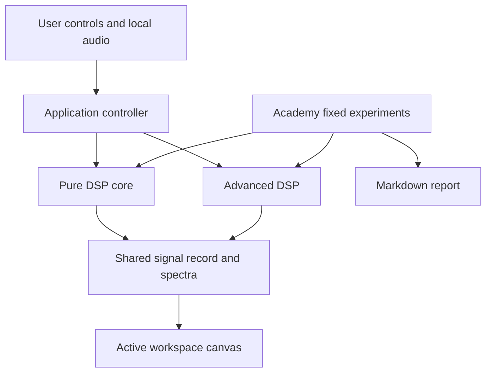

# Engineering notes

## Architecture

| File | Responsibility |
| --- | --- |
| src/dsp/dsp.js | Signal synthesis, radix-2 FFT, magnitude and phase, STFT, statistics |
| src/dsp/advanced.js | Filter design, SOS application, analytic response, roots, IFFT and convolution |
| src/ui/app.js | Input lifecycle, shared numerical record, active-workspace rendering, audio and CSV |
| src/ui/workspace.js / src/styles/workspace.css | Navigation, theme, layout and local preference |
| src/academy/academy.js / src/ui/academy-ui.js | Reproducible experiments, grading, progress and export |
| tests/unit/dsp.test.cjs | Numerical regression suite |

## Equations and conditions

- DFT: `X[k] = sum(x[n] exp(-j 2πkn/N), n=0..N-1)`. FFT requires power-of-two N >= 2. Uniform sample rate fs gives bin spacing fs/N; spacing is not necessarily two-tone resolving power.
- Real single-sided amplitude: `2 |Xw[k]| / sum(w)` for interior bins; DC and Nyquist are not doubled. Exact coherent-tone amplitude requires suitable bin alignment and no interfering spectral leakage. Hann, Hamming and Blackman use periodic definitions. Window selection changes leakage and main-lobe width; coherent-gain normalization does not remove off-bin scalloping loss.
- Frequency folding: `abs(((f+fs/2) mod fs)-fs/2)` with nonnegative modulo. This is a frequency mapping for real sampled sinusoids; phase may suppress a tone at Nyquist.
- Digital Butterworth low-pass: `|H(f)| = 1/sqrt(1+r^(2N))`, where `r=tan(πf/fs)/tan(πfc/fs)`. High-pass uses reciprocal r. Valid for positive cutoff below Nyquist. At fc, gain is approximately -3.0103 dB. Band-pass cascades two edges; overall order is 2N and edge gains need not be -3 dB.
- IIR stability: all poles of a causal rational filter must be strictly inside the unit circle. Coincident roots overlap in the visualization. Filter state starts at zero for every record.
- IFFT: `x[n] = (1/N) sum(X[k] exp(j 2πkn/N))`. Real reconstruction retains conjugate groups ranked by raw spectral energy, with DC and Nyquist counted once.
- Linear convolution: `y[n] = sum(x[k] h[n-k])`, length N+M-1 for finite nonempty sequences with zero extension. Direct O(NM) algorithm; kernel capped by interface.
- STFT: 75% frame overlap; time coordinate is frame center. Display magnitude is relative to record peak and clipped at -60 dB, not calibrated SPL or PSD.

## Performance and threat review (limited)

V2.0 separates analyzer, filter and mathematics drawing. Inactive instrument computations are skipped; common waveform and spectra remain computed. Input and resize events coalesce per animation frame. Imported filenames and student notes are not inserted as executable HTML. Microphone and audio import are local, asynchronous source transitions invalidate stale requests, and microphone tracks are stopped on pagehide. Limits on encoded file bytes and decoded samples reduce retained allocation but cannot prevent decoder allocation before validation. No third-party scripts are loaded. This is a targeted code review, not a penetration test or formal security audit.
