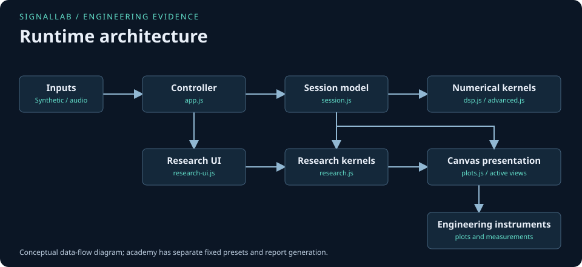
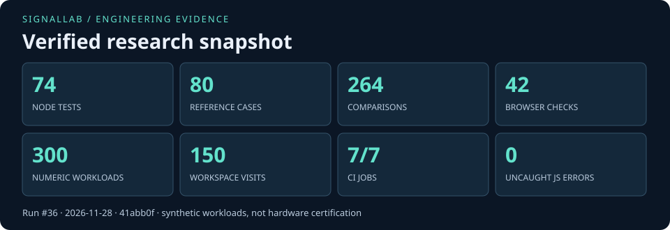

# SignalLab — Interactive DSP Engineering Workbench

**Category:** electrical engineering · digital signal processing · scientific software.

**Challenge:** make sampling, Fourier analysis, filter response and numerical reconstruction inspectable in an interactive, dependency-free browser workbench.

## Engineering solution

Independent radix-2 FFT, STFT, Butterworth SOS, analytic group delay and symmetric windowed-sinc FIR; reusable session and Cartesian rendering modules; fixed synthetic FIR/IIR and leakage research experiments; six guided academy labs. Deterministic modular/portable distribution, no server-side signal processing.

## Verification

[Candidate snapshot 41abb0f](https://github.com/DanoV1m/SignalLab/commit/41abb0fdb9fb9e3be491e1f81c519caa43e1b9d9) passed [run #36](https://github.com/DanoV1m/SignalLab/actions/runs/46140127275), including 74 Node tests, 80 scientific cases, 264 independent numerical comparisons, 42 hosted browser checks, 300 numerical workloads and 150 workspace visits. Read the [evidence register](quality/EVIDENCE.md) for provenance and limits. The main branch is not the research candidate.

## Visual demonstration

[Actual browser captures](https://github.com/DanoV1m/SignalLab/actions/runs/46140127275/artifacts/15261701781), generated in CI; [portable entry point](../web/portable/SignalLab.html). No public live-demo URL or hardware validation claimed. The [research experiment protocol](experiments/RESEARCH_LAB.md) gives reproducible steps and conditions.

## Trade-offs and next work

Local browser computations simplify distribution but limit hard real-time guarantees. Research filters are controlled low-pass experiments; known-component SNR is not blind estimation. Memory diagnostics show increased heap/RSS despite stable DOM counts, so extended soak and retained-object profiling remain open. Physical microphone, formal accessibility/security audit and release approval remain outstanding.

**Repository:** https://github.com/DanoV1m/SignalLab · [Research PR #4](https://github.com/DanoV1m/SignalLab/pull/4). This is a repository case study, not a claim that external portfolio changes were published.
