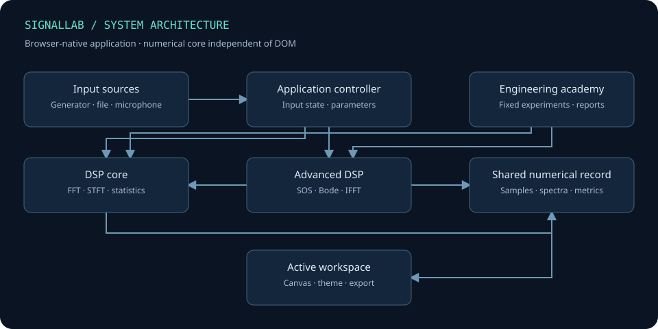
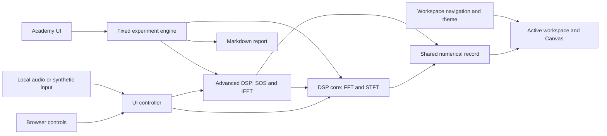
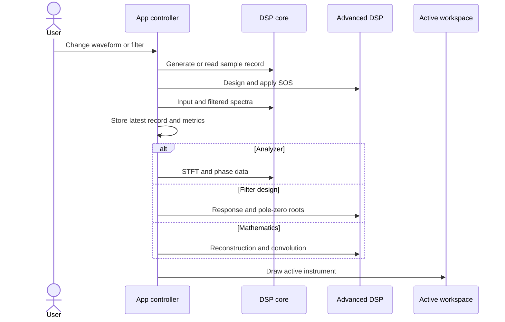
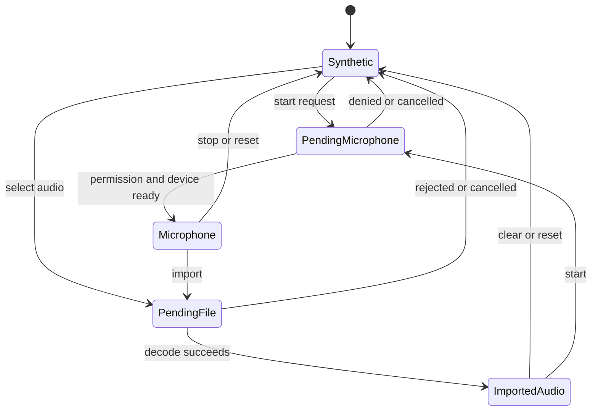
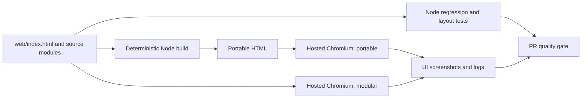
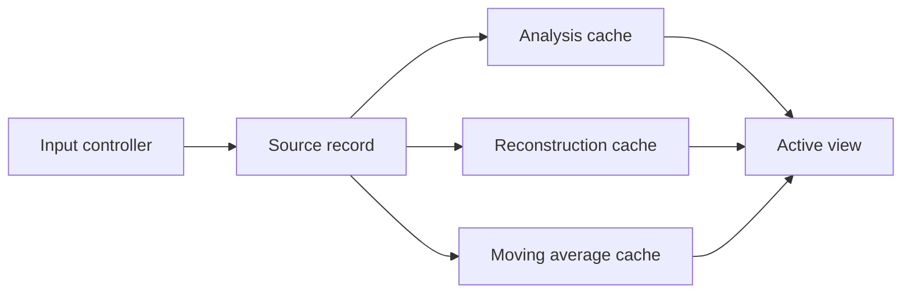

# System architecture

SignalLab is a static browser instrument. Four workspaces and a dashboard share one sample record; numerical kernels can also be imported in Node independently of the DOM.

## 1. Components

| Layer | Files | Contract |
| --- | --- | --- |
| Numerical core | src/dsp/dsp.js | Sample arrays, spectra, metrics and pure numerical functions |
| Advanced DSP | src/dsp/advanced.js | Filter coefficients, response, roots, reconstruction and convolution |
| Session model | src/dsp/session.js | DOM-free source, analysis and independent math caches; immutable arrays by contract |
| Academy | src/academy/academy.js | Fixed IDs, presets, expected values, predictions and report |
| UI | src/ui/app.js, academy-ui.js, workspace.js | Input lifecycle, DOM events, rendering, navigation and progress |
| Presentation | web/index.html, src/styles/workspace.css | Controls, layout, themes and canvases |

Runtime scripts use an ordered classic-script interface; numerical modules expose CommonJS exports for testing. This is not a framework-based application or worker-based streaming pipeline.

## 2. Signal processing sequence

The session model reuses unchanged source and spectrum records and caches reconstruction and moving-average results independently. Microphone frames always use fresh arrays. Inactive advanced calculations remain skipped. No hard real-time scheduling is claimed.

## 3. Input lifecycle

Conceptual state model, not a separate state-machine library. Epoch/token checks invalidate stale asynchronous requests; microphone tracks are released on stop and pagehide.

## 4. Build and verification

CI uploads the portable artifact and screenshots. GitHub Pages remains an owner-controlled step.

## 5. Session cache boundaries

Each cache holds one entry. Synthetic inputs are keyed by generator parameters, imported audio by object identity, offset and record length. Analysis is keyed by sample identity, rate, filter and window; math results by sample identity and their own controls. Stop/reset clears all entries; live samples are newly allocated. The UI treats returned arrays as immutable. The moving-average full convolution uses a sliding sum in O(N+M) time, while general convolution remains O(NM). Floating-point summation differs from the direct algorithm; equivalence is tolerance-tested, not bit-identical.
