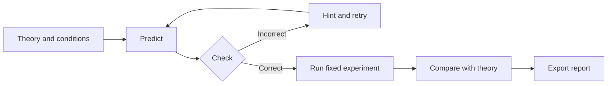

# Guided engineering experiments

Every lab follows theory → prediction → hint → verification → fixed experiment → report. Fixed inputs are independent of the current instrument settings. Predictions are evaluated against explicit tolerances, not by an AI service.

| Experiment | Concept | Verify |
| --- | --- | --- |
| Sampling & Aliasing | Sinusoid beyond Nyquist folds into the sampled band | Folded frequency formula versus FFT peak |
| FFT Resolution | Discrete frequency grid | fs/N versus computed bin spacing |
| Amplitude Normalization | Window coherent gain | Known coherent tone amplitude versus normalized spectrum |
| Butterworth Design | Half-power cutoff | 1/sqrt(2) magnitude, approximately -3.0103 dB |
| Signal Reconstruction | Retain conjugate spectral groups | RMS error for fixed coherent tones |
| Linear Convolution | Finite convolution | Hand-computed output versus numerical sequence |

This is the recommended learning workflow, not a strict lock on controls.

Run `npm test` to reproduce the six fixed experiment checks. Open Engineering Academy to run the same experiments interactively and export a Markdown report with observations.

Suggested future exercises (not implemented): compare Hann and rectangular windows for off-grid tones; explore two-tone spacing and filter transient response. Report conditions rather than assuming bin spacing is resolving power.
