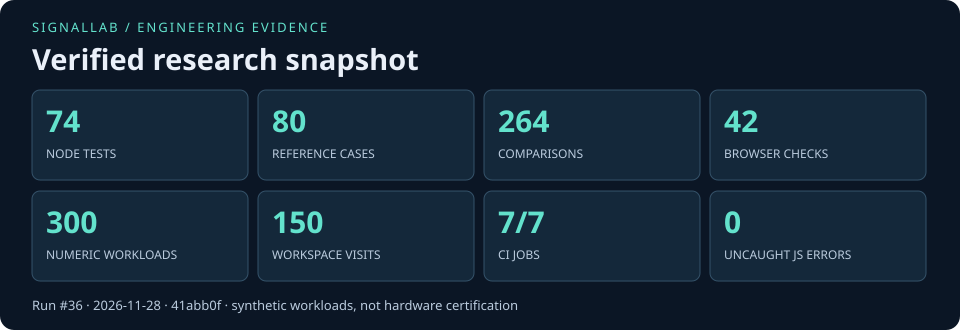
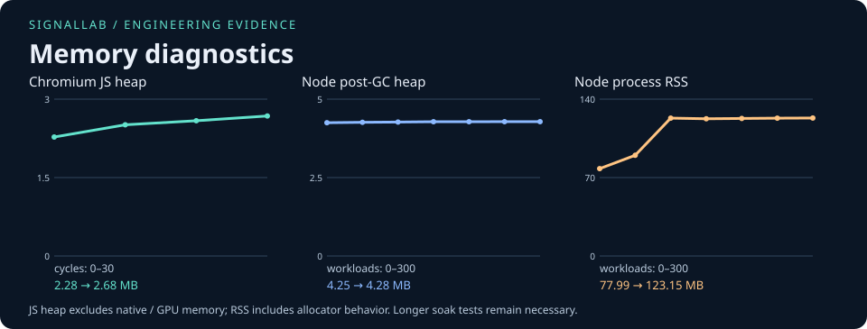

# Engineering evidence — verified snapshot

**Snapshot:** [41abb0f](https://github.com/DanoV1m/SignalLab/commit/41abb0fdb9fb9e3be491e1f81c519caa43e1b9d9), 2026-11-28, [run #36](https://github.com/DanoV1m/SignalLab/actions/runs/46140127275). All seven jobs passed on this commit; these are historical measurements, not live badges or future guarantees.

| Evidence | Result | Source |
| --- | ---: | --- |
| Node regression | 74/74 | verify job |
| Scientific validation | 80 cases, 264 comparisons | scientific-reference job |
| Chromium smoke | 42 checks in two distributions | browser job |
| Compatibility | Chromium, Firefox, WebKit | three synthetic compatibility jobs |
| Numerical workload | 300/300, 4096 samples | reliability job |
| Browser workload | 30 cycles, 150 visits, zero uncaught JS errors | reliability job |

## Visual evidence

[Actual screenshot artifact](https://github.com/DanoV1m/SignalLab/actions/runs/46140127275/artifacts/15261701781) — eight PNG files (dashboard, analyzer, filter, mathematics, each modular and portable). Generated by Playwright in the successful browser job. The screenshots were downloaded and inspected as a contact sheet. They are not checked into source because this connector accepts text writes, and the binary upload has no direct file-reference handoff. Artifact retention is finite; regenerate via the browser tests if expired. Diagrams in this handbook are conceptual or data-derived, not screenshot substitutes.

## Memory and performance

[Raw reliability reports and stress dashboard capture](https://github.com/DanoV1m/SignalLab/actions/runs/46140127275/artifacts/15261077454). Node 22.23.5: 300 workloads in 2947.59 ms; median 9.632 ms, p95 11.248 ms. Browser: 30 cycles in 12609.59 ms total; not isolated input latency.

| Workload / counter | Initial | Final |
| --- | ---: | ---: |
| Node heapUsed (bytes) | 4248936 | 4282200 |
| Node arrayBuffers (bytes) | 10475 | 10475 |
| Node RSS (bytes) | 77987840 | 123154432 |
| Chromium JS heap (bytes) | 2275732 | 2677876 |
| Chromium DOM nodes | 1065 | 1065 |
| Chromium listeners | 89 | 89 |
| Chromium documents | 1 | 1 |

Node post-GC heap grew by 0.78%; RSS by 57.9%, and Chromium JS heap by 17.7%. The rising browser heap warrants a longer soak and retained-object profiling; no leak-free claim. The measurements exclude GPU/native browser memory and physical device validation. See [reliability protocol](RELIABILITY.md).

## Reproduction and boundaries

Use [the verified commit](https://github.com/DanoV1m/SignalLab/commit/41abb0fdb9fb9e3be491e1f81c519caa43e1b9d9), not a changing branch tip, to reproduce these measurements. Run npm test, npm run reference and npm run stress, then the hosted browser suites in [test strategy](TEST_MATRIX.md). CI is read-only and uploads artifacts; no live site is claimed. No formal accessibility or security certification.
